# Looks

The Daily Task Automator in 8 UI styles. Each folder is the full app locked to one look.
The main app (`../index.html`) has all of them: switch in the 🎨 Look panel.

Tasks and sync are shared: every look reads the same tasks.

These pages are generated from `index.html`. After changing it, run `node scripts/build-styles.js`.

## [Skeuomorphism](skeuomorphism/index.html)

Real-world materials: bevels, glossy buttons, an LCD clock.

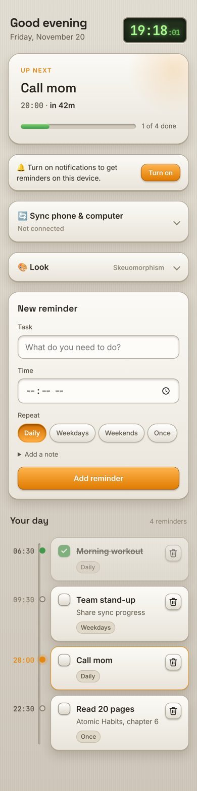 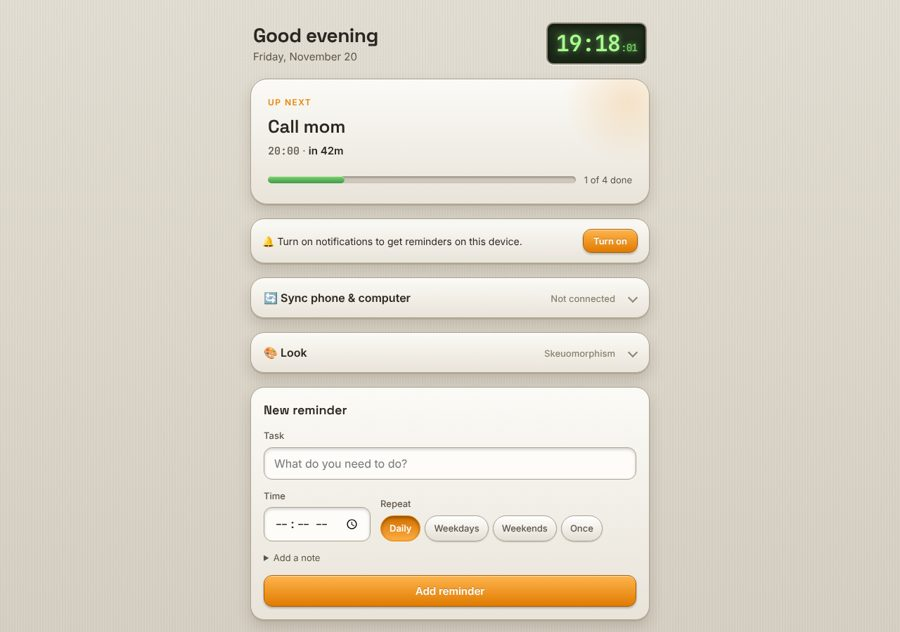

## [Neumorphism](neumorphism/index.html)

Soft shapes pressed out of one colour, made with light and shadow.

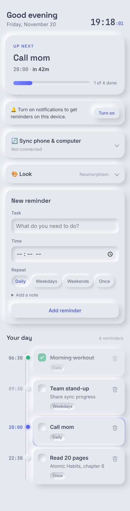 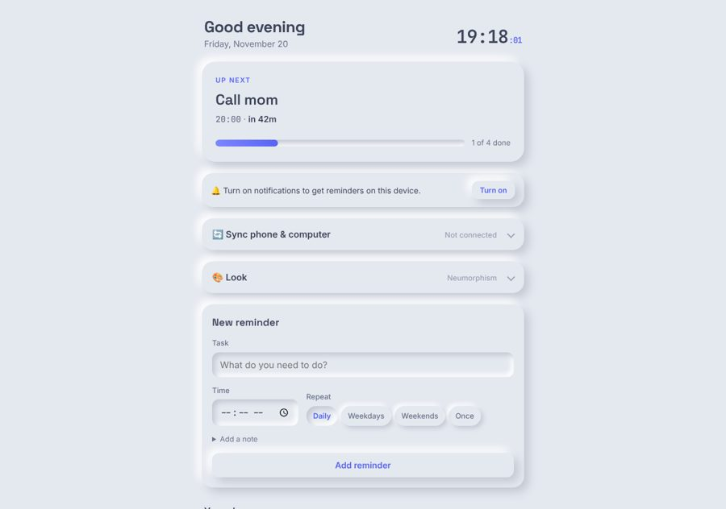

## [Glassmorphism](glassmorphism/index.html)

Frosted see-through panels over bright colour blobs.

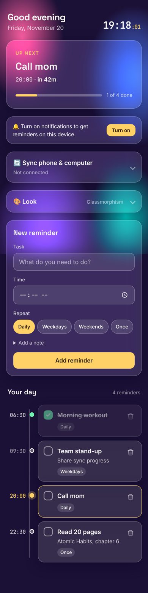 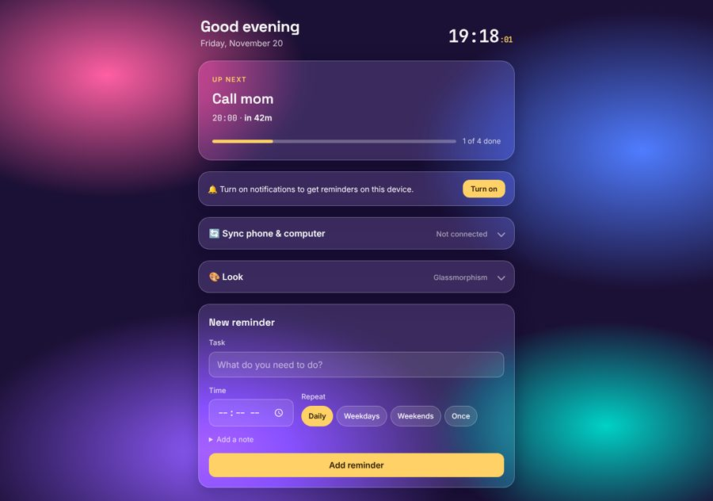

## [Claymorphism](claymorphism/index.html)

Puffy, rounded, pastel cards that look like clay.

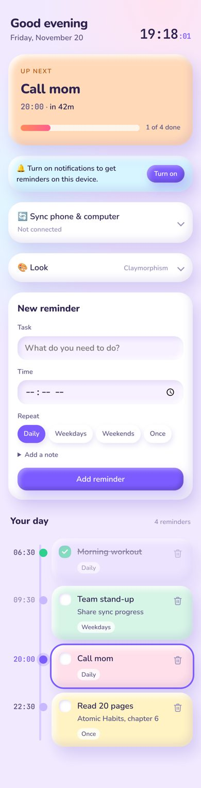 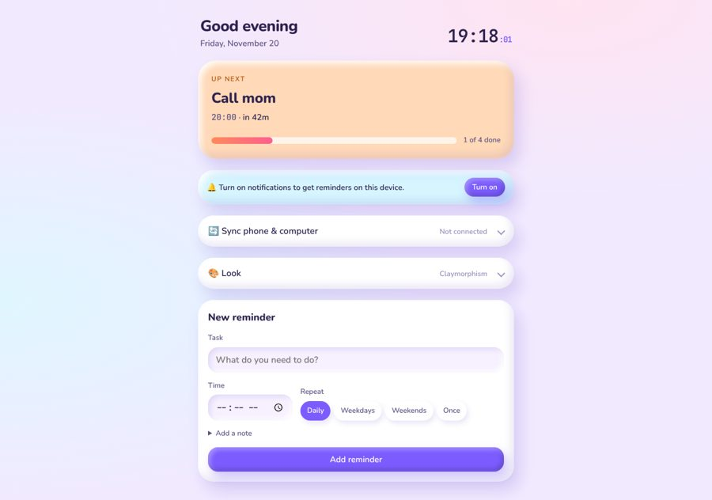

## [Brutalism](brutalism/index.html)

Raw: thick black borders, hard shadows, no rounding, lime accent.

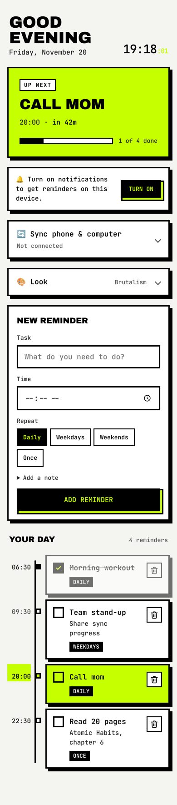 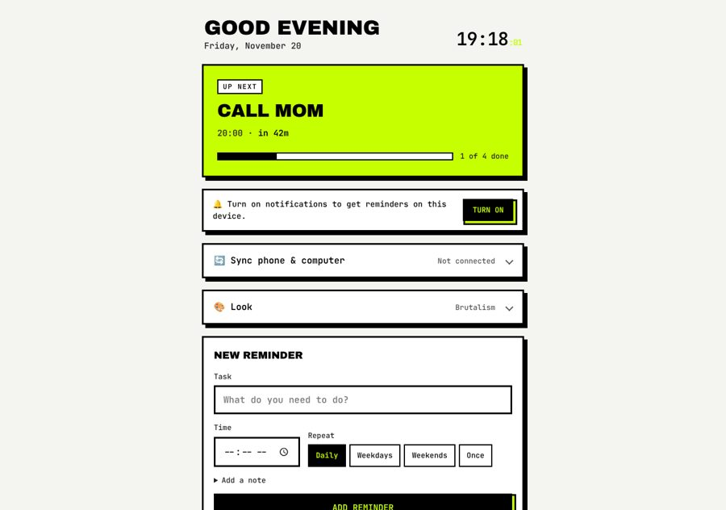

## [Maximalism](maximalism/index.html)

Loud colour, patterns and big type. More is more.

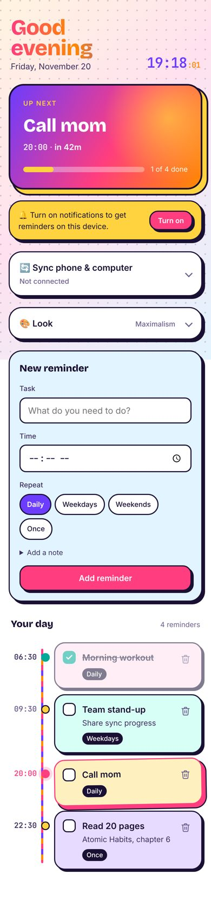 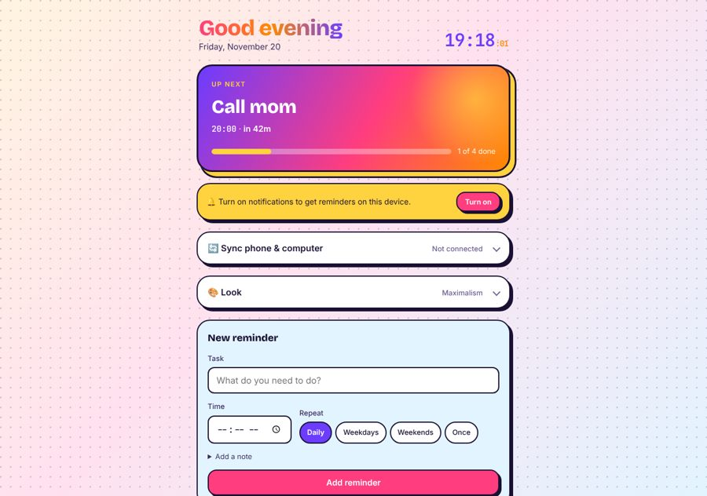

## [Liquid Glass](liquid-glass/index.html)

Clear glass with bright edges and pill-shaped controls on deep colour.

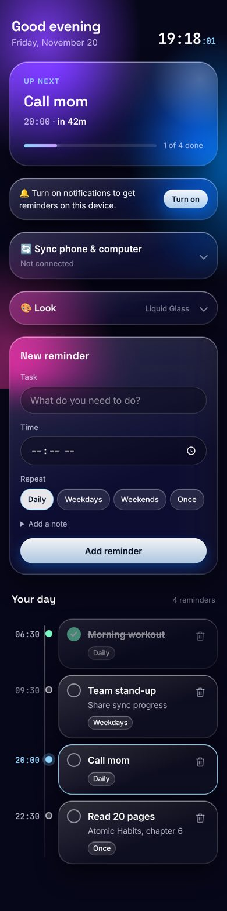 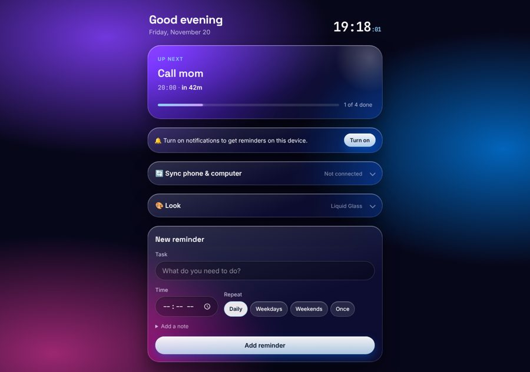

## [Bento Grid](bento-grid/index.html)

Everything as coloured tiles in a grid, like a bento box.

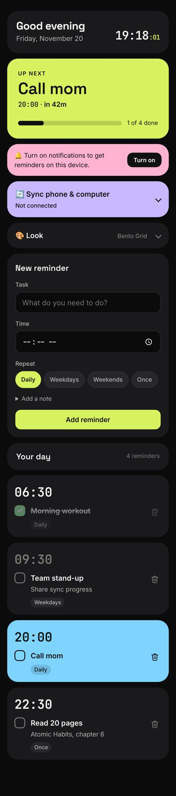 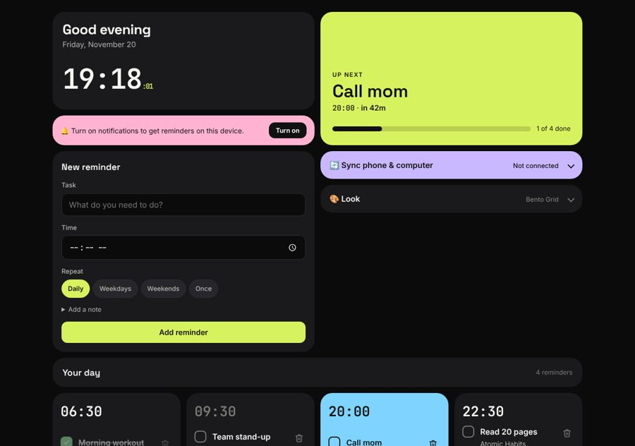
